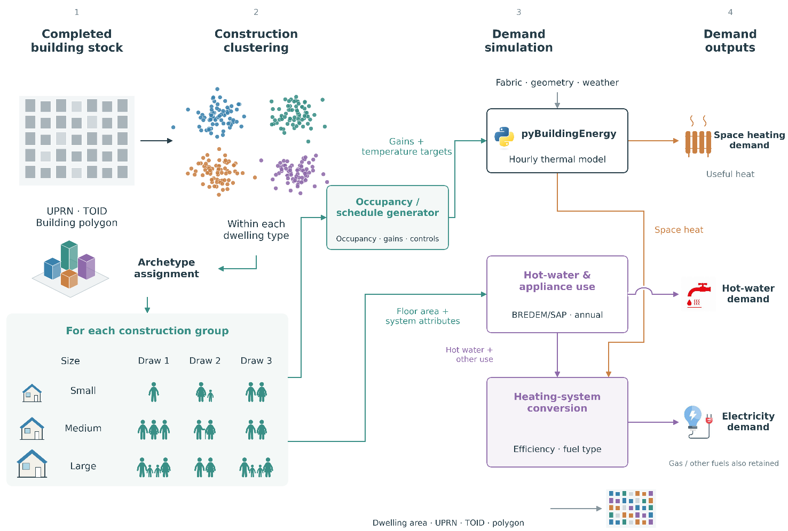
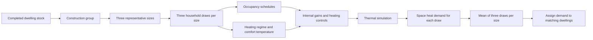
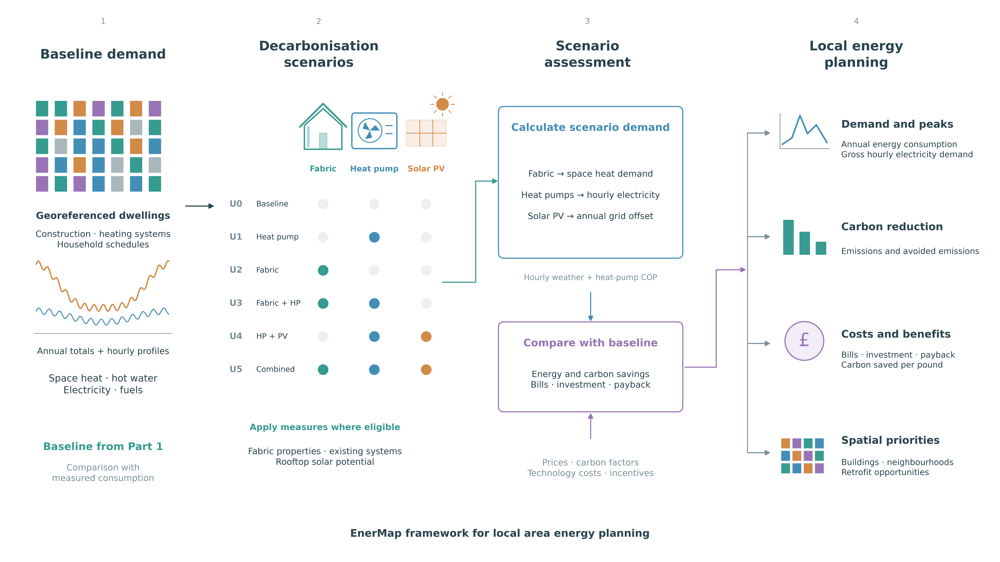

# EnerMap framework for local area energy planning

EnerMap connects completed building stock, construction archetypes and stochastic household schedules to hourly demand simulation and electrification planning. Guildford demonstrates the framework; planning scenarios focus on its dense ten-ward study area.

The current simulation library uses **cluster-median construction properties at three median floor areas**, with three stochastic household draws for each size. Original dwelling records and clustering are preserved. Baseline, retrofit scenarios and the downstream interface have all been rerun consistently; the preceding results remain in Git history.

## From archetypes to demand



For each construction group, the three representative sizes are simulated with three household and behaviour draws each. The household can differ between draws. The model calculates space heat demand for every draw, then averages the three hourly demand profiles for each representative size. Those size-specific profiles are assigned to the matching dwellings.



## From demand to decarbonisation and LAEP



Baseline demand provides the starting point for comparing fabric retrofit, heat pumps and rooftop solar. Energy consumption, electricity peaks, emissions and costs are assessed to identify local priorities for decarbonisation.

## Explore

1. Stock preparation and linkage: notebooks/01_stock.
2. Construction archetypes, size representatives and household schedules: model notebooks 00–04 and the clustering diagnostics.
3. Demand, validation and consistency checks: 05, 06_validation, 07_consistency_checks and 09_lsoa_atlas.
4. Electrification, fabric and PV scenarios: 10_ward_scenarios and 12_planning_visuals.
5. The Streamlit app: validation, time profiles, scenario comparisons, electricity peaks and maps from the same current run.

The rooftop-PV notebook remains in notebooks/03_solar. The separate road-proximity experiment remains in notebooks/04_explorations.

## Public interactive dashboard

[Open the EnerMap dashboard](https://elgenied.github.io/EnerMap-showcase/dashboard/) — publicly available without an account or installation. The map-first planning interface includes LSOA energy demand and emissions, construction archetypes, six decarbonisation scenarios, retrofit and solar potential, equity and carbon priorities, and electricity-network screening. Guildford is the current case study. Maps, filters, budget selection, charts and CSV exports run directly in the browser on GitHub Pages.

See [interface documentation](docs/dashboard/PLANNING_INTERFACE.md) for data scope and refresh instructions. The [research summary](https://elgenied.github.io/EnerMap-showcase/) and [original Streamlit explorer](https://elgenied.github.io/EnerMap-showcase/dashboard/streamlit.html) remain available separately.

## Run the dashboard

Use Python 3.11 or 3.12:

```sh
python -m venv .venv
# Windows PowerShell: .venv/Scripts/Activate.ps1
# macOS/Linux: source .venv/bin/activate
python -m pip install -r requirements.txt
python -m streamlit run app.py
```

The app reads packaged results and does not execute the modelling notebooks. Scenario, area and week controls select saved data. No raw inputs or thermal-engine installation is required to explore the app. A GitHub repository alone is not a hosted Streamlit website.

## Revised incentives and infrastructure results — 9 October 2026

The current run uses four support proxies, EPC D–G screening where applicable, and separate social-housing support. Incentives change net investment, payback and prioritisation, while fixed adoption leaves energy demand unchanged. U5 net investment is **£278.38 million**, and **11.5%** of planning dwellings meet the 12.5-year simple-payback screen.

The hourly substation comparison covers **28,662 dwellings in 271 inferred cells**, with PV capped at 4 kWp per dwelling allocation. U5 imports **140.98 GWh/year** and has a **92.45 MW** winter import peak. Adding PV reduces annual imports but leaves that winter peak unchanged.

- [Results page](https://elgenied.github.io/EnerMap-showcase/)
- [Secondary-substation notebook](notebooks/02_model/14_U4_PV_substation_balance.ipynb)
- [Scenario and incentive assumptions](docs/SCENARIO_NOTES.md)
- [Annual solar potential per inferred cell](outputs/current/u4_pv_balance/annual_solar_potential_by_substation.csv)

The page uses aggregate results. Cell assignments are proximity-based and screening exceedances are not verified overloads. Annual financial accounts retain 45% PV self-consumption; hourly cell imports are reported separately.

## Current results

This presents a case study of EnerMap, presented for Guildford Borough Council, which contains 57,300 dwellings (Residential). Results are 567.6 GWh/year useful space heat, 722.9 GWh/year delivered gas, and 246.6 GWh/year delivered electricity. Scenario tables also include the ten-ward subtotal of 28,663 dwellings. Scope is explicit in every view.

Heat-pump electricity comes from hourly heat/COP and is summed annually. Annual BREDEM/SAP usage and normalised hourly profiles provide one consistent electricity/DHW account.


## Notebook guide


| Notebook | Role |
|---|---|
| [00_data_basis.ipynb](notebooks/02_model/00_data_basis.ipynb) | Current modelling workflow |
| [01_archetypes.ipynb](notebooks/02_model/01_archetypes.ipynb) | Current modelling workflow |
| [02_representatives.ipynb](notebooks/02_model/02_representatives.ipynb) | Current modelling workflow |
| [03_engine_setup.ipynb](notebooks/02_model/03_engine_setup.ipynb) | Current modelling workflow |
| [04_household_schedules.ipynb](notebooks/02_model/04_household_schedules.ipynb) | Current modelling workflow |
| [05_archetype_run.ipynb](notebooks/02_model/05_archetype_run.ipynb) | Current modelling workflow |
| [06_validation.ipynb](notebooks/02_model/06_validation.ipynb) | Current modelling workflow |
| [07_consistency_checks.ipynb](notebooks/02_model/07_consistency_checks.ipynb) | Current modelling workflow |
| [09_lsoa_atlas.ipynb](notebooks/02_model/09_lsoa_atlas.ipynb) | Current modelling workflow |
| [10_ward_scenarios.ipynb](notebooks/02_model/10_ward_scenarios.ipynb) | Current modelling workflow |
| [11_pypsa_interface.ipynb](notebooks/02_model/11_pypsa_interface.ipynb) | Internal downstream ---Softlink with PyPSA-LAEP |
| [12_planning_visuals.ipynb](notebooks/02_model/12_planning_visuals.ipynb) | Current modelling workflow |
| [notebook13_clustering_diagnostics.ipynb](notebooks/02_model/notebook13_clustering_diagnostics.ipynb) | Current modelling workflow |

| [14_U4_PV_substation_balance.ipynb](notebooks/02_model/14_U4_PV_substation_balance.ipynb) | Hourly PV, annual solar per cell and U0–U5 infrastructure screening |
